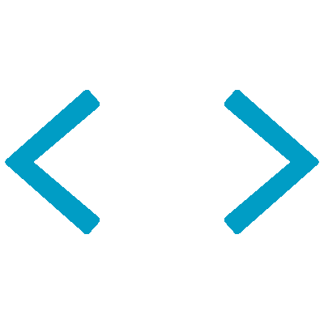

# 👋👋👋 Welcome to my profile 👋👋👋

<!--
**fugithora812/fugithora812** is a ✨ _special_ ✨ repository because its `README.md` (this file) appears on your GitHub profile.

Here are some ideas to get you started:

- 🔭 I’m currently working on ...
- 🌱 I’m currently learning ...
- 👯 I’m looking to collaborate on ...
- 🤔 I’m looking for help with ...
- 💬 Ask me about ...
- 📫 How to reach me: ...
- 😄 Pronouns: ...
- ⚡ Fun fact: ...
-->
## 💼 Career Summary

**株式会社ZENKIGEN** | 2022年4月 - 現在  
採用DXサービス「[harutaka](https://harutaka.jp/)」開発チーム

- **2024年 -** サブリーダーとして開発チームをリード
  - 開発・運用の主担当として各ステークホルダーとコミュニケーション
  - 社員・業務委託メンバーの採用活動に従事
  - 新規開発チームへのプロダクト運用知見の提供
  
- **主な成果**
  - **大規模データ移行**: Interview Maker事業承継に伴う約15万件のデータ移行を設計・実行
  - **コスト最適化**: CloudSQL (MySQL) 5.7→8.4アップグレード対応により、システム原価を大幅削減
  - **インフラ改善**: 複数の開発環境のCloudSQLインスタンス統合で月額10万円のコスト削減を実現
  - **CI/CD改善**: CircleCI→GitHub Actions移行、CI実行時間を60%短縮
  - **セキュリティ強化**: 脆弱性診断プロセスの推進、BCP試験の実施
  - **新機能開発**: 構造化議事録機能、外部ツール連携機能の設計・実装

 
##   My Skill Set  
 

<!-- ref: https://profilinator.rishav.dev/ -->

<table><tr><td valign="top" width="33%">

### Frontend  

  
  
  
  
  
  
  
  
  
  

</td><td valign="top" width="33%">

### Backend  

  
  
  
  
  
  
  

</td><td valign="top" width="33%">

### DevOps  

  
  
  
  
  
  
  

</td></tr></table>  

   

## 🚀 Key Projects

### 採用DXサービス「harutaka」(2022年4月 - 現在)
**Role:** Full-stack Engineer → Sub-leader (2024-)  
**Tech Stack:** Ruby on Rails, React, TypeScript, Google Cloud (GKE, CloudSQL, Cloud Build), AWS (S3, MediaConverter)

#### Technical Achievements
- 大規模システムのデータベースアップグレード（MySQL 5.7→8.4）とパフォーマンス最適化
- Interview Maker事業承継に伴う15万件超のデータ移行プロジェクトをリード
- インフラコスト最適化施策により月額コストを大幅削減
- CI/CD パイプラインの改善（実行時間60%短縮）
- セキュリティ強化（脆弱性診断、BCP試験の推進）

#### Feature Development
- 構造化議事録機能の設計・実装（AI活用した面接文字起こしのカテゴリ分類）
- 外部ツール連携機能の設計・実装
- フロントエンドライブラリの大規模アップデート対応

---

### 図版収集・構成ツール開発 (2022年12月 - 2023年5月)
**Role:** Lead Frontend Engineer  
**Tech Stack:** React, TypeScript, Vite, Firebase, OpenAPI, Playwright

- スキーマ駆動開発の導入によるBE/FE間の連携強化
- ドラッグ&ドロップ機能の実装
- E2Eテストの導入とCI/CD環境の構築
- ESLint/Prettierによるコード品質管理の確立

---

### 学術研究支援サービス (2021年5月 - 12月)
**Role:** Developer → Project Leader  
**Tech Stack:** Golang, PostgreSQL, Docker, JavaScript

- OSSプロトタイプを予定より2週間早期に実装完了
- プロジェクトリーダーとしてチームの進捗管理を担当
- 顧客との密なコミュニケーションにより手戻りを最小化

---

### 学術研究データ管理サービス (2021年1月 - 4月)
**Role:** Full-stack Engineer  
**Tech Stack:** Python, Django, TypeScript, Docker

- 配属初日から実装着手し、高速な開発サイクルを実現
- バックエンド・フロントエンド両面での機能拡充を担当

 

---

## 💪 Strengths

- **Technical Leadership**: サブリーダーとしてチームをリードし、採用活動にも従事
- **Full-stack Development**: フロントエンドからバックエンド、インフラまで幅広く対応
- **Cost Optimization**: インフラコスト削減やシステム効率化の実績
- **AI Native**: 生成AIも効果的に活用し、即戦力として貢献
- **Problem Solving**: 大規模データ移行やシステムアップグレードなど複雑な課題を解決
- **Communication**: ステークホルダーとの調整や技術的な意思決定を推進

 

---

*Let's build something great together!* 🚀

